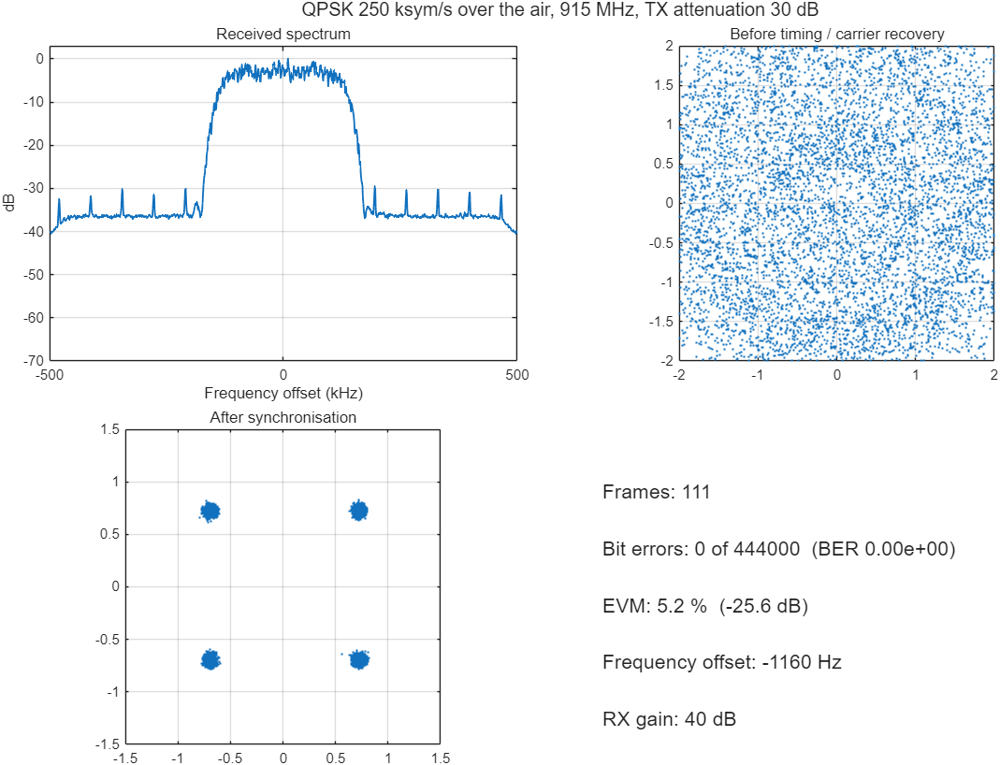
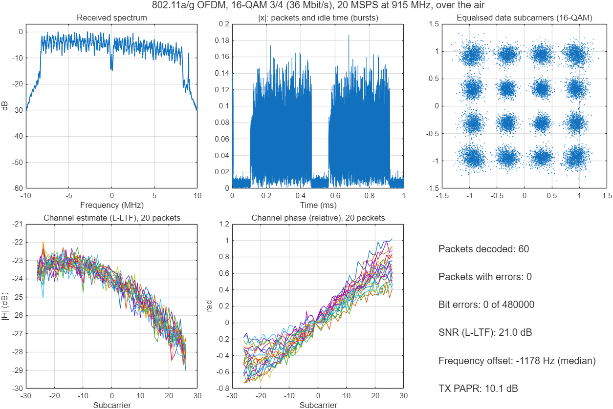
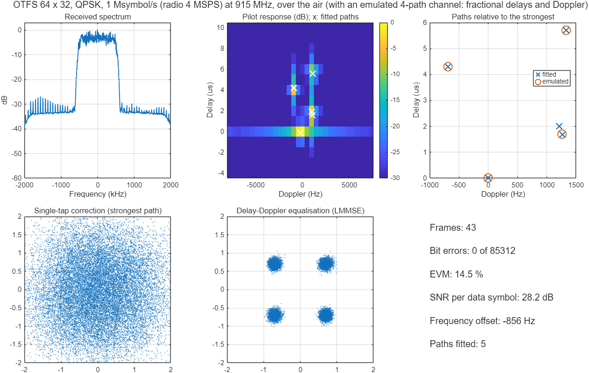
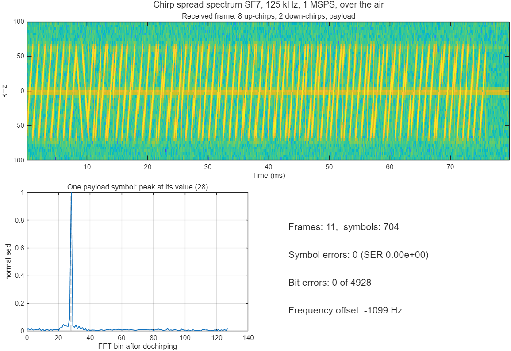
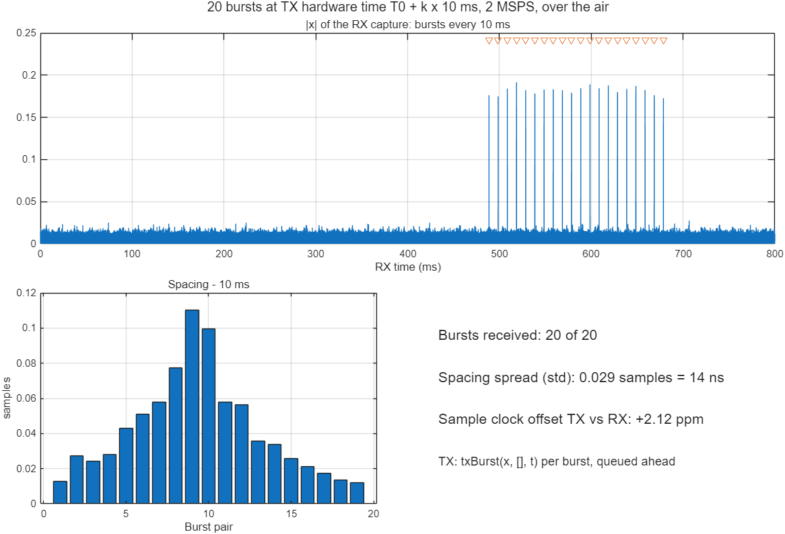
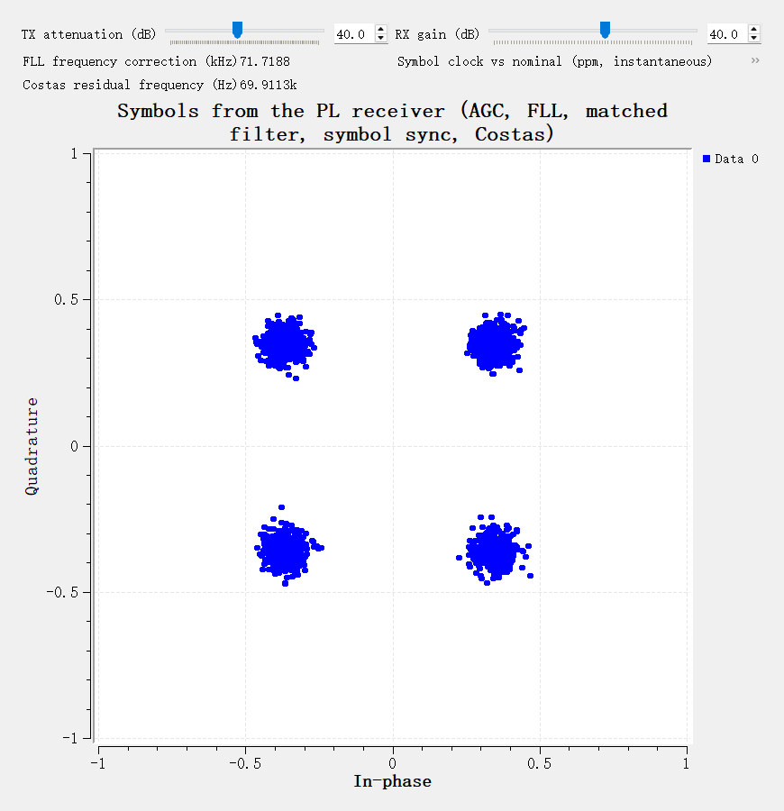
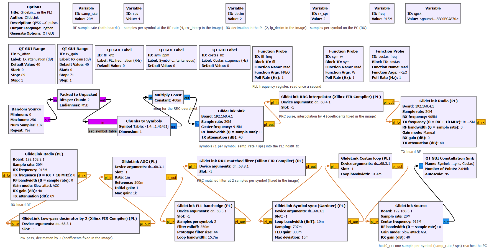
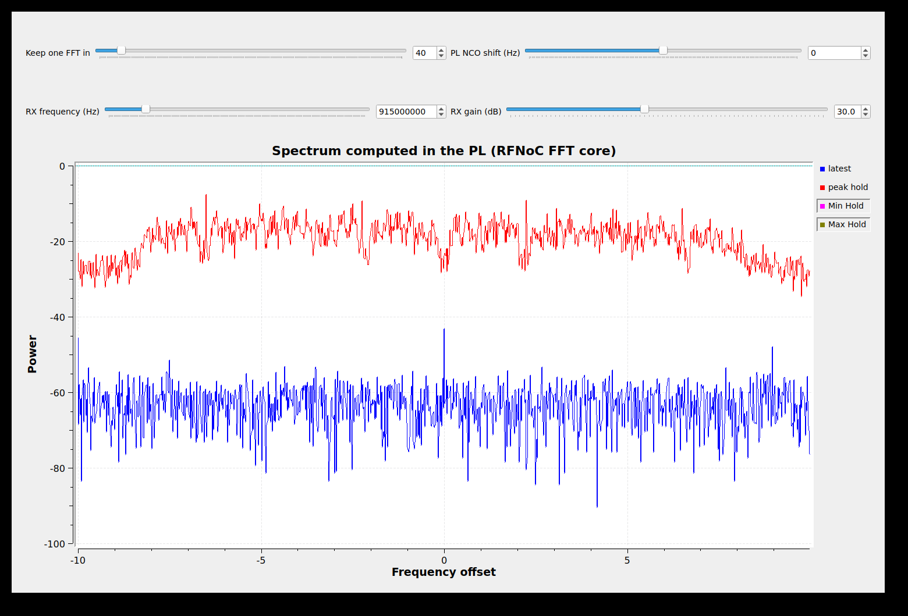
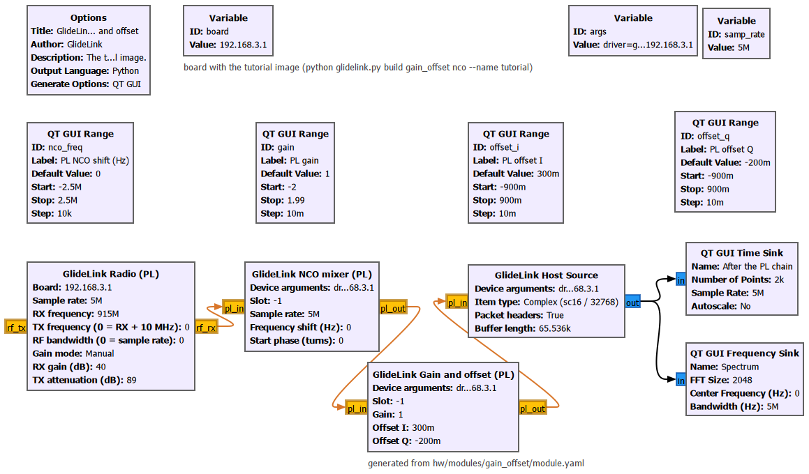

# GlideLink SDR：通信算法原型验证平台

## 1. 解决什么问题

通信算法从仿真走到实物，通常要跨过三道坎：

- 仿真里的算法要接真实射频，得自己处理驱动、采样传输、增益控制、时间同步；
- 在电脑上跑通的处理链，采样率一高电脑就跟不上，必须搬进FPGA；
- 搬进FPGA意味着重写整套数据通路、寄存器接口和上位机软件，验证也要从头来。

GlideLink SDR用两块PYNQ-ZU加AD9361 FMC子卡，把这三步连成一条路：

1. 先在MATLAB或GNU Radio里用真实射频验证算法，现有的软件和例程基本不用改；
2. 算法中吃算力的部分写成FPGA模块，用户只写数据处理本身，其余由平台生成；
3. 在GNU Radio里把软件块换成对应的FPGA块，同一个流程图从纯软件逐步变成全硬件，最终可以脱离电脑运行。

| 项目 | 指标 |
|---|---|
| 射频 | 70 MHz～6 GHz，带宽至56 MHz，每块板1收1发 |
| 采样率 | 0.52～50 MSPS |
| 与电脑连接 | 每块板一根USB线 |
| 支持的软件 | SoapySDR生态（GNU Radio、GQRX、自己的程序）、MATLAB |

## 2. SoapySDR：现有工具直接可用

平台提供标准的SoapySDR驱动，所以凡是支持SoapySDR的软件都能直接用这块板子，不需要为它单独开发：

- GQRX、SoapySDRUtil、GNU Radio的gr-soapy、自己写的Python/C++程序；
- 程序在电脑上和在板上都能运行，只是设备地址不同。

实际效果：

- 经一根USB线，电脑与板子之间收发同时各50 MSPS，逐样点无丢失；
- AD9361驱动的全部参数（增益控制模式、AGC各项阈值等）和芯片寄存器都能从标准接口访问，做射频前端相关研究不受限制；
- 每包数据带硬件时间戳，可以按硬件时间定时发送，满足突发通信、雷达这类需要精确时序的实验。

## 3. MATLAB：只装MATLAB就能做空口实验

电脑上只需要MATLAB，不装任何驱动或支持包，几行代码就能在两块板之间收发：

```matlab
tx = glidelink.Radio("192.168.4.1");  rx = glidelink.Radio("192.168.3.1");
tx.config(Rate=1e6, Freq=915e6, TxAtten=30);  rx.config(Rate=1e6, Freq=915e6, RxGainMode="manual", RxGain=40);
tx.txCyclic(x);                % 在板上循环发送
[y, t] = rx.rx(1e6);           % 在板上采集后发回，t为第一个样点的硬件时间
```

采集在板上完成后再发回电脑，所以高采样率下也不丢样点。

实际效果：

- 多种体制在两块板之间空口实测均0误码：QPSK、2-FSK、线性调频扩频、802.11a/g OFDM、OTFS，以及按硬件时间精确排定的突发（20个全收到，间隔离散14 ns）。










- MathWorks官方的USRP、ADALM-Pluto和WLAN工具箱例程，只把射频收发换掉就能运行，信号处理部分原样保留：

| 官方例程 | 实测 |
|---|---|
| QPSK收发（USRP版、Pluto版） | 各136万比特，0误码 |
| 频偏校正 | 校正后残差约10 Hz |
| FM立体声解调 | 左右声道隔离43 dB |
| 802.11图像传输 | 包全部正确收到，BER 0 |
| FMCW雷达测距 | 测得板上收发固定延迟56个采样 |

- ADALM-Pluto的MATLAB支持包也能直接按地址连接这块板子。

对课题组来说，这意味着教材和论文里基于MATLAB的算法可以直接拿到真实信道上验证。

## 4. GNU Radio：流程图里软件块和FPGA块可以互换

GRC中每个FPGA模块都有两个块：一个跑在FPGA里，一个是功能相同的软件参考实现。FPGA块之间的连线就是FPGA内部的数据路由，数据不经过电脑，用法与Ettus的RFNoC相同。

### 实际效果：QPSK链路逐步搬进FPGA

两块板之间5 Msymbol/s的QPSK，射频20 MSPS，每一步只改流程图：

| 步骤 | FPGA里做的 | 电脑实际收到 | 符号EVM |
|---|---|---|---|
| 纯软件 | 无 | 12～16 MSPS（应为20，电脑跟不上，持续丢样） | 不稳定 |
| 发射成形进FPGA | 插值成形 | 7～16 MSPS（接收仍跟不上） | 约−19 dB |
| 接收抽取也进FPGA | ＋低通抽取 | 10 MSPS，不再丢样 | 约−19.5 dB |
| 整个接收机进FPGA | ＋AGC、频偏校正、匹配滤波、符号同步、载波同步 | 5 MSPS，只收符号 | 约−19.6 dB |

纯软件时电脑处理不了20 MSPS；整条接收机放进FPGA后，电脑只需要收已经同步好的符号，链路稳定。整个QPSK接收机在FPGA中只用了42个DSP。





另一个例子：射频→混频→FFT全在FPGA里完成，20 MSPS的实时频谱只把结果送到电脑。



## 5. FPGA模块：只写算法本身

这是平台最核心的部分。传统做法里，把一个算法放进FPGA，大部分工作量花在算法以外：数据怎么从射频进来、怎么分包加时间戳送到电脑、跨时钟域、寄存器总线、上位机驱动和界面。在这个平台上，这些全部由平台负责。

### 用户写什么

| 文件 | 内容 |
|---|---|
| 模块RTL | 只有数据处理：标准AXI4-Stream输入输出（`tdata`、`tvalid`、`tready`），寄存器就是普通的输入输出端口 |
| `module.yaml` | 模块名、寄存器表、GNU Radio块的参数及其到寄存器的换算 |
| `model.py`（可选） | Python参考模型，用来做自动比对 |

由平台自动生成的：寄存器总线与地址译码、GRC中的FPGA块和软件块、测试向量、Python按名字读写寄存器的接口。

### 从写好RTL到在GRC里使用：四条命令

```bash
python glidelink.py new gain_offset                         # 生成能直接用的模块骨架
python glidelink.py test gain_offset                        # 仿真，与参考模型逐拍比对
python glidelink.py build gain_offset nco --name tutorial   # 生成FPGA镜像（约半小时）
python glidelink.py deploy 192.168.3.1 tutorial             # 部署到板子并核对
```

部署后，模块的两个块就出现在GRC中。FPGA块按模块ID自己找到所在位置，换镜像、调整模块顺序都不用改流程图。

### 正确性怎么保证

- 仿真时自动加入随机间隙和反压，输出与参考模型逐拍比对，寄存器全部读回核对；
- 上板后，同一段数据分别经FPGA块和软件块处理，逐样点比较。QPSK链路的全部模块与软件模型逐比特一致。

### 实际效果

以"增益加直流偏置"模块为例：写完RTL后，仿真4组用例逐拍一致，构建13分钟，上板4组各131072个样点与软件块完全相同，在GRC里三个参数运行中可调。



已经有的模块：

| 类别 | 模块 |
|---|---|
| 基础 | 混频（NCO）、FIR、增益偏置、FFT/IFFT（移植自Ettus RFNoC） |
| QPSK链路 | 根升余弦插值、低通抽取、匹配滤波、AGC、频偏校正（FLL）、符号同步（Gardner）、载波同步（Costas） |
| DeepJSCC-Q图像传输 | OFDM发射、OFDM接收、编码器、解码器 |

其他能力：可以直接使用Xilinx IP（如FIR Compiler）、可以引用第三方RTL库、每个模块可单独设定处理时钟。

## 6. 对课题组的意义

- 新的通信算法可以直接从MATLAB仿真走到真实射频上的空口验证，中间不需要做任何硬件或驱动开发；
- 已有的MATLAB例程和GNU Radio流程图基本不用改就能跑；
- 需要实时处理或高采样率时，只写算法的RTL就能放进FPGA，并且自动与软件实现比对，不必搭建整套FPGA工程；
- 竞赛作品的DeepJSCC-Q图像传输系统已经迁移到平台上，可以脱离电脑独立运行，说明完整的端到端系统也能在这个平台上实现。
