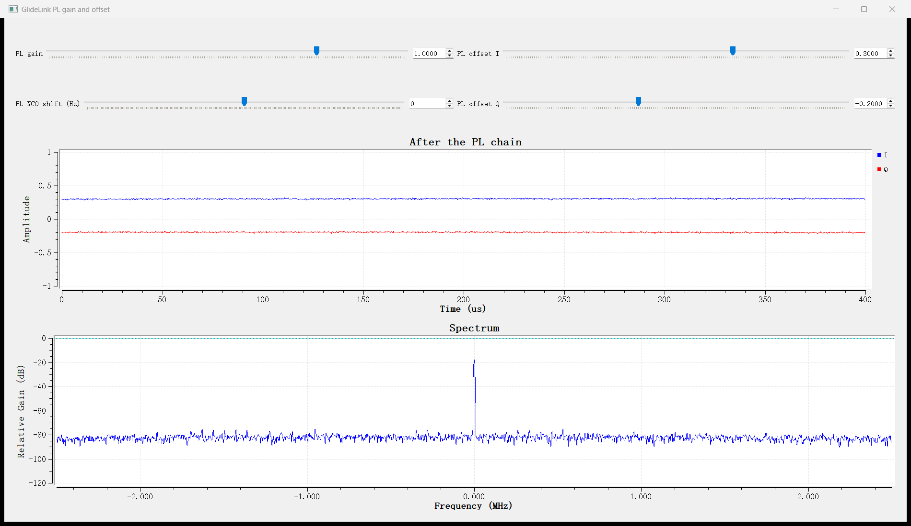

# 自定义 FPGA 模块

一个模块放在 `hw/modules/<id>/`，开发者写三样东西：

| 文件 | 内容 |
|---|---|
| RTL | 模块本身：时钟复位、`flush`、AXI4-Stream 输入输出，寄存器以普通端口的形式出现 |
| `module.yaml` | 名字、RTL 文件、寄存器表、GNU Radio 块的参数（及其到寄存器的换算） |
| `model.py`（可选） | 参考模型：寄存器级的 Python 类 `Model` |

其余由脚本生成：

| 生成的东西 | 来源 | 由谁生成 |
|---|---|---|
| 寄存器文件 `<top>_slot.v`：AXI4-Lite、地址译码、ID / VERSION、读回多路选择，把模块接进槽位 | 寄存器表 | `hw/scripts/gen_module.py`，构建镜像（`gen_image.py`）与仿真（`run_module_sim.ps1`）时自动调用，不进源码树 |
| GNU Radio 的 PL 块 `glidelink_<id>`（只写寄存器，橙色端口在 PL 内连线）与软件块 `glidelink_<id>_model`（跑参考模型） | `block` 段 + `model.py` | 安装 gr-glidelink 时（`install_conda.py` 或 CMake） |
| Python 中按名字读写寄存器 | 寄存器表 | `gnuradio.glidelink.modules.slot_registers`，PL 块的 `read(名字)` / `write(名字, 值)` |

PL 块按模块 ID 自己找槽位（槽位参数填 -1，默认值），换镜像、调整槽位顺序都不用改流程图。

从写好 RTL 到在 GRC 里使用，是仓库根目录 `glidelink.py` 的四条命令（第 5 节是完整的例子）：

```bash
python glidelink.py new <id>              # 骨架：直通模块，能直接测试、构建
python glidelink.py test <id>             # 仿真，与参考模型逐拍比较，并检查寄存器读回
python glidelink.py build <id> [<id> ...] --name <镜像>
python glidelink.py deploy <板子地址> <镜像>
```

再重新安装 gr-glidelink，模块的两个块就出现在 GRC 中。`python glidelink.py status <板子地址>` 显示板子的开机镜像和各槽位的模块。

## 1. 模块的端口

```verilog
module my_gain (
  input             clk,
  input             rstn,
  input             flush,                  // 流开始时外壳清空槽位：模块按需复位自己的处理状态，寄存器保留

  // 寄存器（module.yaml 中声明，寄存器文件由脚本生成）
  input             enable,                 // CONTROL[0]
  input             soft_reset,             // CONTROL[1]，写 1 时一个周期的脉冲
  input     [15:0]  gain,                   // GAIN

  input             s_axis_tvalid,
  output            s_axis_tready,
  input     [31:0]  s_axis_tdata,           // sc16：{Q[31:16], I[15:0]}

  output            m_axis_tvalid,
  input             m_axis_tready,
  output    [31:0]  m_axis_tdata
);
```

数据流是标准的 AXI4-Stream，每拍一个 sc16 样点，只有 `tdata`、`tvalid`、`tready`，按握手收发即可，两侧都可能被反压。
样点怎样分包、带时间戳送到电脑或射频，由平台处理，模块不用管。

一个输入不是对应一个输出的模块，在 `module.yaml` 中写明输出个数（平台据此处理）：

| `rate` | 含义 |
|---|---|
| 不写 | 一个输入一个输出 |
| `{interp: L}`、`{decim: M}`、`{interp: L, decim: M}` | 每 M 个输入对应 L 个输出（插值、抽取）；L、M 可以写含寄存器端口的表达式，如 `"enable ? 4 : 1"`（关闭时直通） |
| `variable` | 输出个数不是固定比例，如符号同步每个符号输出一个 |

`python hw/scripts/gen_module.py ports <id>` 按 `module.yaml` 打印模块应有的端口表，可以直接复制进 RTL。

寄存器与端口的对应：

| 寄存器表中的写法 | 模块端口 |
|---|---|
| 读写寄存器 `NAME`（默认） | `input [W-1:0] name`：写入的值，复位后为 `default` |
| 读写位域 | `input [W-1:0] <位域名>` |
| 位域 `access: pulse` | `input <位域名>`：每次写 1 时一个周期的脉冲，读回 0 |
| `strobe: true` | 另加 `input name_wr`：每次写一个周期，`name` 同时给出数据 |
| `access: wo` | `input [W-1:0] name` 与 `input name_wr`，读回 0 |
| `readback: true` | 另加 `output [W-1:0] name_rd`：读这个寄存器时返回它，不返回写入的值 |
| `access: ro` | `output [W-1:0] name`：模块给出的值；写了常量 `value`（可以用模块参数，如 `TAPS`）时没有端口 |

端口名是寄存器名的小写，位域用位域名。地址从 0x008 起按顺序每个占 4 字节，0x000 / 0x004 固定为 ID 与 VERSION（取自 `id_value`、`version`）；
个别寄存器要固定地址时写 `offset`。读写都是单周期，模块不用处理总线握手。

## 2. module.yaml

以 NCO 为例（`hw/modules/nco/module.yaml`）：

```yaml
id: nco
name: NCO mixer
rtl: glidelink_nco.v
top: glidelink_nco
model: model.py
id_value: 0x4E434F31          # "NCO1"，ID 寄存器的值，PL 块靠它找槽位
version: 1.0.0
registers:
  - name: CONTROL
    fields:
      - {name: enable, bits: 0, doc: "1 = mix, 0 = pass unchanged"}
      - {name: soft_reset, bits: 1, access: pulse}
  - {name: STATUS, access: ro, fields: [{name: enabled, bits: 0}]}
  - {name: FREQ, doc: "phase increment per sample = f / fs * 2^32"}
  - {name: PHASE, strobe: true, readback: true}
block:
  doc: Frequency shift by freq.
  params:
    - {name: samp_rate, label: Sample rate, type: real, default: 1.0e+6, grc_default: samp_rate}
    - {name: freq, label: Frequency shift (Hz), type: real, default: 0.0,
       write: {FREQ: "freq / samp_rate * 2**32"}}
    - {name: phase, label: Start phase (turns), type: real, default: 0.0, write: {PHASE: "phase * 2**32"}}
  start: {CONTROL: 1}
```

| 键 | 含义 |
|---|---|
| `parameters` | RTL 参数及默认值；镜像文件中可按槽位覆盖 |
| `uses` | 用到的源码库目录（`hw/modules` 下，如 `phy_common`、`uhd_rfnoc`） |
| `ip` | Xilinx IP（`.xci`） |
| `rate` | 输出个数与输入个数的关系（第 1 节） |
| `bus: module` | 模块自己实现 AXI4-Lite（例如寄存器访问要多个周期的第三方核：`fft` 的包装要经 RFNoC 的 CtrlPort 读写核内寄存器）；这时不生成寄存器文件，寄存器表只给软件用，每项写 `offset` |
| `block` | GNU Radio 块，见下 |
| `exact: false` | 参考模型不是逐比特的（如 FFT 用浮点），软件块说明中不写"逐比特一致" |

`block.params` 每一项是 GRC 中的一个参数，PL 块与软件块相同：

| 键 | 含义 |
|---|---|
| `name`、`label`、`type`、`default` | `type`：`real`、`int`、`bool`、`string`、`enum`、`int_vector`、`real_vector`；`grc_default` 是 GRC 中的默认表达式（如变量名 `samp_rate`） |
| `options` | `enum` 的选项：`[[值, 显示名, 寄存器值], ...]` |
| `check` | 必须成立的条件，如 `"8 <= size <= 4096"` |
| `write` | 参数设定时写的寄存器：`{寄存器: 表达式}` 或 `[[寄存器, 表达式], ...]`；表达式给出列表时逐个写同一寄存器；`[[A, B], 表达式]` 对列表中每个二元组依次写 A、B |
| `doc` | 一句说明，进入 GRC 的块说明 |

表达式是 Python，可用各参数（`enum` 取寄存器值）、`read('寄存器')`、`log2(n)`（必须是 2 的幂）、`pad(列表, n)`、`round`、`min`、`max`、
`math` 与模块自己的 `model`（如 FFT 的 `model.default_scaling(...)`）；结果取整并截成 32 位。块启动时按顺序写所有参数，再写 `start`；运行中改一个参数，
重写所有用到它的项（例如 NCO 的 `samp_rate` 变了，FREQ 随之重写）。

## 3. 参考模型

`model.py` 中的 `Model` 类继承 `module_desc.RegisterModel`，在寄存器层面模仿模块：寄存器按名字存放，`on_write` / `on_read` 处理写入的副作用和
由模块给出的读数，`process(words)` 处理一段样点（`uint32` 的 sc16 字），状态留在对象里，输出个数可以和输入不同。

```python
class Model(module_desc.RegisterModel):
    def __init__(self, params=None):
        super().__init__(module_desc.load("nco", os.path.dirname(HERE)), params)
        self.phase = 0

    def on_write(self, name, value):
        if name == "PHASE" or (name == "CONTROL" and value & 2):
            self.phase = self.regs["PHASE"]

    def on_read(self, name):
        return self.phase if name == "PHASE" else None

    def process(self, words):
        out, self.phase = process(words, self.regs["FREQ"], self.phase, bool(self.field("CONTROL", "enable")))
        return out
```

软件块与 PL 块用同一段"参数 → 寄存器"的换算：软件块把寄存器写给 `Model`，PL 块写给板上的槽位。所以软件块就是 PL 模块在电脑上的替身，
流程图里把一个换成另一个（PL 块前后接主机端口源 / 汇或射频块），输出应当相同（`sw/tests/gr_proxy_swap.py`）。

## 4. 命令

| 命令 | 做什么 |
|---|---|
| `new <id> [--name 名字]` | 建 `hw/modules/<id>/`：`module.yaml`（寄存器 CONTROL.enable / soft_reset，ID 值自动选一个不重复的）、`glidelink_<id>.v`（一级流水的直通，端口表按 yaml 生成）、`model.py`（直通的 `Model`）。不改任何东西就能通过 `test`、能构建 |
| `test <id> [--case K]` | 对 `module.yaml` 中 `tests` 的每一项（块参数，或寄存器名加原始值）：按与 GNU Radio 块相同的"参数 → 寄存器"换算写寄存器，送 6000 个随机 sc16 样点（满幅噪声、单音、小信号、极值，随机长度的包），测试平台随机插入间隙与反压，输出与 `Model` 逐拍比较，并检查输出能被平台正确送出（`rate` 写得不对会报错），最后读回全部可读寄存器与 `Model.read` 比较。各用例之后再测一次数据流中途的清空（`flush`，板上开始一条流时外壳会这样清空路径上的槽位）：之后的输出要回到与模型一致，开头允许有一段由模块残留状态（如滤波器延迟线中的旧样点）带来的差别；清空时模块里还没送出的数据由平台丢弃，模块不用自己清。输出个数与输入不同的模块（如 FFT）在激励后再送一段输入：按块处理的模块在下一块没凑满时可能扣住上一块（Xilinx FFT 核在一帧中途断供时整体停住），然后比较激励应出的全部输出，模型不逐比特时允许 `tolerance` LSB；`test_input_scale` 缩小激励幅度。没有参考模型时只检查能仿真、有输出。向量在 `hw/modules/<id>/build/test<K>/`。需要 Windows 上的 Vivado（xsim） |
| `build <镜像>` 或 `build <id> ... --name <镜像>` | 镜像文件 `hw/images/<镜像>.yaml`，或直接列模块（放在槽位 1、2……，槽位 0 是外壳的直通，写成 `hw/images/<镜像>.yaml` 留着下次用）；跑 Vivado（约一小时，打印各阶段），产物与时序余量：`hw/build/<镜像>/glidelink_<镜像>.bit`、`.hwh`、`image.json` |
| `deploy <板子> [<镜像>]` | 不写镜像时用最近构建的。拷到板子开机镜像所在目录（设备树叠加与外壳无关，沿用板上现有的），改 `/etc/default/glidelink-bridge`，重启，等桥接服务把镜像加载好，逐个槽位读 ID 与 `image.json` 核对。`--no-reboot` 只设开机镜像 |
| `status <板子>` | 开机镜像与各槽位的模块（按 ID 认出 `hw/modules` 中的模块） |

本机的工具与板子的登录在环境变量或仓库根目录的 `glidelink.local.yaml`（不进 git）中：`VIVADO`（vivado 可执行文件）、`ADI_HDL_DIR`（编好库的 ADI HDL，见 `hw/README.md`）、
`GLIDELINK_SSH_KEY`、`GLIDELINK_SSH_USER`（默认 root）。

上板核对软件块与 PL 块：`python sw/tests/gr_module_swap.py <id> --args driver=glidelink,uri=ip:<板子地址>`（在装了 gr-glidelink 的环境中运行，
Windows 在开始菜单的 "radioconda Prompt" 中运行：直接调用 `D:\radioconda\python.exe` 时环境没有激活，SoapySDR 的驱动模块加载不了）。它用 `tests` 的每一项参数，把同一段信号分别送进软件块和经主机端口 1 送进 PL 块，逐样点比较。

底层的单项操作仍可单独用：`hw/library/glidelink_module/tb/run_module_sim.ps1 hw/modules/<id> -Vectors <目录>`（按自己的 `regs.hex`、`in.hex`、`out.hex`、
`reads.hex` 仿真），`GLIDELINK_IMAGE=<镜像>` 直接跑 Vivado（`hw/README.md`），手动换镜像见用户指南第 4 节。

## 5. 例子：增益加直流偏置

目标：I、Q 各乘一个增益再加一个偏置，饱和到 16 位；GRC 里三个参数（增益、I 偏置、Q 偏置）运行中可调。完整的结果在 `hw/modules/gain_offset/`。

1. 建骨架，先确认它本身能通过：

   ```bash
   python glidelink.py new gain_offset --name "Gain and offset"
   python glidelink.py test gain_offset
   ```

2. `module.yaml`：加三个寄存器，块参数与换算，测试用例。

   ```yaml
   registers:
     - name: CONTROL
       fields:
         - {name: enable, bits: 0}
         - {name: soft_reset, bits: 1, access: pulse}
     - {name: GAIN, width: 16, signed: true, default: 16384, doc: "gain, 1.0 = 16384"}
     - {name: OFFSET_I, width: 16, signed: true}
     - {name: OFFSET_Q, width: 16, signed: true}
   block:
     params:
       - {name: gain, label: Gain, type: real, default: 1.0, check: "-2 <= gain < 2", write: {GAIN: "gain * 16384"}}
       - {name: offset_i, label: Offset I, type: real, default: 0.0, write: {OFFSET_I: "offset_i * 32768"}}
       - {name: offset_q, label: Offset Q, type: real, default: 0.0, write: {OFFSET_Q: "offset_q * 32768"}}
     start: {CONTROL: 1}
   tests:
     - {}
     - {gain: 1.7, offset_i: 0.25, offset_q: -0.5}
     - {gain: -2.0, offset_i: -1.0, offset_q: 0.999}
   ```

   `python hw/scripts/gen_module.py ports gain_offset` 打印新的端口表（多了 `gain`、`offset_i`、`offset_q` 三个输入），复制进 RTL。

3. RTL（`glidelink_gain_offset.v`）：第一级算乘积，第二级舍入、加偏置、饱和，两级一起受反压控制。没有一行总线代码。

4. 参考模型（`model.py`）中的 `process`：

   ```python
   s16 = lambda v: (v & 0xFFFF) - ((v & 0x8000) << 1)
   g = s16(self.regs["GAIN"])
   i, q = unpack(words)
   return pack(sat16(((i * g + (1 << 13)) >> 14) + s16(self.regs["OFFSET_I"])),
               sat16(((q * g + (1 << 13)) >> 14) + s16(self.regs["OFFSET_Q"])))
   ```

5. 仿真、构建、部署：

   ```bash
   python glidelink.py test gain_offset                         # 4 组，各 6000 个样点逐拍一致，寄存器读回一致
   python glidelink.py build gain_offset nco --name tutorial    # 槽位 1 增益偏置，槽位 2 NCO
   python glidelink.py deploy 192.168.3.1 tutorial              # 重启后核对槽位
   ```

6. 重新安装 gr-glidelink，GRC 的 GlideLink / FPGA modules 中出现 GlideLink Gain and offset (PL) 与 (software)。
   上板核对：`python sw/tests/gr_module_swap.py gain_offset`。示例 `sw/gr-glidelink/examples/pl_gain_offset.grc`：射频 → NCO → 增益偏置 → 主机端口 1，
   拖动滑块时 I / Q 的直流台阶和 0 Hz 处的谱线随之变化。

   

   2026-11-01 在接收板上：`test` 4 组仿真逐拍一致；`build` 13 分钟，时序满足；`deploy` 核对槽位通过；`gr_module_swap.py gain_offset` 4 组各 131072 个样点与软件块完全相同。

## 6. 定点位宽与分时复用

PL 的乘法器（DSP48E2）是有限的资源。写 RTL 之前先回答两个问题：每一步究竟需要多少位，每个样点有多少个时钟周期可用。

### 6.1 位宽：按需要定，不按最宽定

DSP48E2 的乘法器是 27×18 位（有符号）。两个操作数一个不超过 27 位、一个不超过 18 位，乘法占 1 个 DSP；超出就要 2 到 4 个 DSP 拼起来。
所以定点化时先确定每个量需要多少位，而不是把输入位宽一路加上去：

- 结果要右移的乘法，被移掉的低位对结果的影响可以先算出上界。例如 symsync 的环路是 `(e K) >> 30`：e 去掉低 9 位，结果最多变化 K / 2^21 个最低位。
  K 不到 2^21，所以变化小于 1 个最低位，和右移本身向下取整的误差相当。去掉 9 位后 e 是 25 位，正好放进 27 位端口。
- 影响不好直接算的，用参考模型仿真来定。FLL 的误差 e 是 37 位；锁定后 |e| 的中位数约 2^20、最大约 2^24。去掉低 12 位使频率估计变化不超过约
  50 Hz，而环路本身的抖动约 500 Hz（10 MSPS 时），所以只留 25 位。
- 增益一类跨好几个数量级的参数，用“尾数 + 移位”两个寄存器：尾数 17 位（无符号，作为 18 位有符号操作数），移位量由块参数换算时选到尾数不溢出的最大值，
  相对精度约 2^-17。FLL、Costas 的 `ALPHA` / `ALPHA_SHIFT`、`BETA` / `BETA_SHIFT`，symsync 的 `KP` / `KP_SHIFT`、`KI` / `KI_SHIFT` 都是这样。

位宽定下来以后写进参考模型，RTL 与模型逐位一致，测试才有意义。

### 6.2 分时复用：时钟比采样率高多少，一个乘法器就算多少次

槽位时钟 200 MHz，而接收机里的采样率是几到 25 MSPS，每个样点有 8 到几十个时钟周期。一个乘法器在这些周期里依次算不同的乘积，
用操作数选择器（按步骤切换输入）加一个输出寄存器实现，乘法器数就降到“每个样点的乘法次数 ÷ 每个样点的周期数”：

| 模块 | 每个样点的乘法 | 分时后的乘法器（DSP） | 每个样点的周期 | 最高采样率（200 MHz） |
|---|---|---|---|---|
| `fll` | 旋转 4 次 + 带边滤波 4×48 次 + 误差 2 次 + 环路 2 次 | 20：滤波 12 个乘法（4 种乘积 × 3 路）加 4 个放进 DSP 的累加器，旋转与最新抽头共用 2，误差 1，环路 1 | 16 | 12.5 MSPS |
| `symsync` | Farrow 8 次 + 误差 2 次 + 环路 2 次（每个符号） | 3：I、Q 各 1 个依次算全部乘积，另 1 个是放进 DSP 的加法 | 每个符号 16（2 个样点） | 25 MSPS |
| `costas` | 旋转 4 次 + 环路 2 次 | 2 | 7 | 28 MSPS |
| `agc` | 2 次 | 1 | 5 | 40 MSPS |

有反馈的环路要注意：一个样点的输出依赖上一个样点更新的状态（NCO 相位、增益），这条递推链上的步骤不能拆开流水。
FLL 的处理办法是把带边滤波拆成两部分：旧样点的 47 个抽头只依赖历史，在处理当前样点的同时就为下一个样点算好；
只有最新样点的一个抽头留在递推链上。这样递推链只有十几个周期，滤波器的乘法器可以充分分时。

综合的一个坑：共用乘法器的输出寄存器若接到几个不同的加法上，Vivado 会把加法并进 DSP 的后加器，为此把乘法器复制成几份，
分时省下的 DSP 又回来了。给这个寄存器加 `(* keep = "true" *)` 即可（`fll`、`costas` 中的 `m0`、`m1`），改完用综合报告核对每个模块的 DSP 数。

FIR Compiler 等 IP 自己就会做这件事：按 `Clock_Frequency` 与 `Sample_Frequency` 之比决定每个乘法器分担几个抽头（第 7 节）。

## 7. 使用 Xilinx IP

模块里可以直接实例化 Vivado 的 IP（FFT、FIR Compiler、CORDIC、DDS 等）。仓库中的例子：`fft`（FFT IP）、`ofdm_rx`（6 个 IP），
以及 QPSK 链路中的三个滤波器 `rrc_interp`、`lp_decim`、`rrc_mf`（FIR Compiler，下面逐步说明）。

IP 已经做好了时序、资源复用和各种结构优化，自己写不划算时用它。需要逐样点完全掌控的环路（AGC、FLL 等）自己写 RTL 更合适。

### 7.1 系数固定还是运行时重载

FIR Compiler 可以把系数固定在镜像里，也可以开一个重载通道在运行时改系数。按使用场景选：

- QPSK 链路里的滤波器（发端成形、收端抽取前的低通、匹配滤波）在整个通信过程中不变，用固定系数。固定系数时 IP 能利用系数的对称性，
  乘法器减半，也不需要重载通道、系数存储和配置逻辑。
- 系数要在运行中改变的场合才用重载，例如按工作模式切换不同的滤波器。重载有自己的约定：系数要按 IP 内部的存放顺序送（生成 IP 时写出的
  `<IP 名>_reload_order.txt`，既不是正序也不是倒序），重载完成后要送配置包，在下一个数据样点生效，复位不清除未完成的重载，
  外层逻辑要按这些约定处理。
- 自适应均衡器的系数每个符号都按 LMS 等算法更新，这是另一类结构，通常自己写 RTL，而不是用 FIR Compiler 的重载通道。

仓库中运行时可改系数的例子是自己写的 `fir`（系数寄存器，GRC 中直接填系数）。

### 7.2 系数文件

固定系数放在模块目录的 `ip/<id>.coe`。系数由脚本从参考模型生成，保证 IP 与模型用的是同一组数：

```python
# hw/modules/rrc_mf/model.py
def taps():
    return fir_fixed.quantize(fir_fixed.rrc(23, 2, 0.35, 1.0), 15)   # 2 倍过采样、滚降 0.35、11 个符号，×2^15
```

```bash
python hw/modules/fir_fixed/fir_fixed.py hw/modules/rrc_mf       # 写出 ip/rrc_mf.coe
```

`fir_fixed/` 中是三个滤波器模块共用的部分：系数设计（`fir_fixed.py`）、生成 IP 的脚本（`make_fir_ip.tcl`）和 IP 外层的 RTL（`glidelink_fir_fixed.v`）。

### 7.3 生成 IP 配置（.xci）

IP 的配置只放一个 `.xci` 文件在模块的 `ip/` 目录。用 Tcl 脚本生成，配置写在脚本里，以后要改就改脚本重跑，不必在图形界面里点：

```tcl
# hw/modules/fir_fixed/make_fir_ip.tcl（节选）
create_project -in_memory -part xczu5eg-sfvc784-2-e          ;# PYNQ-ZU 的器件
create_ip -name fir_compiler -vendor xilinx.com -library ip -version 7.2 -module_name $id -dir $tmp
set_property -dict [list \
  CONFIG.Filter_Type $type  CONFIG.CoefficientSource COE_File  CONFIG.Coefficient_File $dir/ip/$id.coe \
  CONFIG.Coefficient_Structure Inferred  CONFIG.Number_Paths 2  CONFIG.Data_Width 16 \
  CONFIG.Output_Rounding_Mode Full_Precision  CONFIG.Clock_Frequency 200  CONFIG.Sample_Frequency $fs \
  CONFIG.Has_ARESETn true  CONFIG.Reset_Data_Vector true  CONFIG.M_DATA_Has_TREADY true \
] [get_ips $id]
```

```bash
cd hw/modules/rrc_mf
vivado -mode batch -source ../fir_fixed/make_fir_ip.tcl -tclargs . Single_Rate 1 25
```

脚本把 `.xci` 写到 `ip/`，并打印 IP 的输出位宽，填进模块顶层 RTL 的 `localparam OW`。`Coefficient_Structure Inferred` 让 IP 从系数判断对称性；
`Sample_Frequency` 填模块要支持的最高输入采样率，IP 据此决定乘法器的分时程度。各个 `CONFIG.*` 参数的名字可以在 Vivado 中
`list_property [get_ips <名字>] CONFIG.*` 列出，含义见该 IP 的产品手册（FIR Compiler 是 PG149）。槽位时钟是 200 MHz（镜像文件中可选 100 / 250），
IP 里的时钟频率按此填写。

### 7.4 在 module.yaml 与 RTL 中引用

```yaml
uses: [fir_fixed]                 # 共用的 RTL（glidelink_fir_fixed.v）
ip: [ip/rrc_mf.xci]               # 可以有多个
ip_files:                         # IP 要读的文件：IP 名 -> {参数名: 模块目录下的文件}
  rrc_mf: {Coefficient_File: ip/rrc_mf.coe}
```

RTL 里按 `module_name` 实例化（`rrc_mf i_ip (...)`），只接配置中启用了的端口：端口表在生成目录的 `<IP 名>.xml`，或 Vivado 生成的实例化模板 `.veo` 中。
构建镜像时脚本把 `.xci` 导入工程（`ip_files` 中的路径改成绝对路径），综合前自动生成 IP。

系数固定的模块，GNU Radio 块没有系数参数（`block.params: []`），只读的 `TAPS`、`INTERP`、`DECIM` 寄存器给出镜像中的滤波器长度和倍数。

### 7.5 仿真

不用另做什么：`glidelink.py test` 与 `run_module_sim.ps1` 第一次遇到带 IP 的模块时，用 Vivado 导出 IP 的仿真模型到仿真工作目录（几分钟），之后复用。
FIR 这类结果确定的 IP，输出可以与模型逐样点比较；FFT 这类内部定点细节不公开的 IP，在 `module.yaml` 中写 `exact: false` 与 `tolerance`。

### 7.6 读手册，再用仿真核对：IP 自己的约定

IP 的接口有它自己的规则，写外层逻辑前要按手册核对，手册没写清的用 IP 的仿真模型确认，再写进参考模型。三个滤波器模块用到的几条：

| 约定 | 来源 | 外层逻辑与模型的做法 |
|---|---|---|
| 多路数据 | PG149：`Number_Paths = 2` 时两路共用系数，输入 32 位（低 16 位第 0 路），输出每路按字节对齐（31 位占 32 位） | I 路接第 0 路、Q 路接第 1 路；输出从第 OW−1 位符号扩展，再舍入、移位、饱和到 16 位 |
| 复位 | PG149：`aresetn` 至少保持 2 个周期；`Reset_Data_Vector` 使复位清空数据存储 | 软复位与流开始时的清空给 IP 复位 8 个周期，再等 16 个周期才送数据 |
| 插值的输出时刻 | 仿真：45 个系数分 4 相时，IP 的第一个输出是 0，之后才是第一个输入的响应 | `rrc_interp` 的模型用 `[0] + 系数` 计算 |
| 抽取的相位 | 仿真：第一个输出对应第一个输入 | `lp_decim` 的模型保留第 0、2、4……个滤波结果 |

## 8. 安装 GNU Radio 块

新模块或改了 `module.yaml` 之后重新运行 gr-glidelink 的安装（Windows：`D:\radioconda\python.exe sw\gr-glidelink\install_conda.py`；
Linux：CMake 安装），模块的两个块出现在 GRC 的 GlideLink / FPGA modules 分类中。
